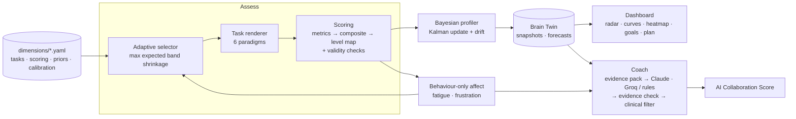

# AI4Brain: Cognitive Growth Agent

**CISTAC 1.0 · AI4Brain challenge entry.** A non-clinical agent that continuously **assesses** six cognitive skills with classic cognitive-science tasks, plus how well you rely on AI advice, **understands** performance as an uncertainty-aware profile (the *Brain Twin*), **coaches** with claims you can verify trial by trial, and **improves** you with adaptive exercises, weekly plans and goals.

> Every number comes with a band that says how sure the app is, every coach claim links to its evidence, and the whole pipeline is checked against 500 simulated users with known abilities.

## What makes it different

| | |
|-|-|
| **Real paradigms** | N-back, Stroop, Corsi blocks, symbol-digit coding, task switching and *generated* Raven-style matrices, plus **Second opinion**, a two-stage game where you answer, see an AI helper's answer, then decide; only disagreements count, conditional on whether your first answer was right (Schemmer et al. 2023). Each has a measurement card (definition, scoring, uncertainty, biases, references) at `/skills` |
| **Uncertainty everywhere** | Bayesian (Kalman) profile per skill: 90% band on every estimate, wider for noisy or invalid blocks, widening between sessions |
| **Adaptive testing** | The next block is the one expected to shrink the band most. In simulation this is **10% more accurate than random order** at equal effort |
| **Validated** | 500 simulated users through the real pipeline: band coverage **89–94%** (target 90%), mean error ±6–10% on the cognitive skills, **98% of invalid play caught** with 1% false alarms (`/validation`, [docs/validation.md](docs/validation.md)) |
| **Evidence-linked coach** | Claude or an open-weight model on Groq writes claims that must cite the exact blocks and trials, and may add published findings (13 reviewed science cards) to explain why; science alone never counts as evidence; every number in a claim is checked against the evidence it cites; unsupported claims are dropped; a clinical-term filter guards every word and norm comparisons are removed; falls back to a rule-based coach |
| **AI Collaboration Score** | Documented formula over 18 behaviour signals, including graded results from the second-opinion game, plus an opt-in **spot-the-error mode** that measures whether you check the AI ([docs/collaboration-score.md](docs/collaboration-score.md)) |
| **Forecasts that grade themselves** | Growth forecast with a widening band, and a **track record**: past forecasts are checked against what actually happened |
| **Surprise-proof** | Skills are YAML config: `npm run new-dimension` adds a skill live with no code change ([docs/adding-a-dimension.md](docs/adding-a-dimension.md)) |

## Challenge requirements → where to find them

| Brief | Implementation |
|-|-|
| A: tasks per dimension; score, RT, error rate, behaviour; dimension docs; non-biometric mode | 6 cognitive skills + AI reliance, 1 task each, 3 levels each (`dimensions/*.yaml`); every trial stored with RT, correctness and behaviour; measurement cards (`/skills`, [docs/measurement-cards.md](docs/measurement-cards.md)); non-biometric only |
| Brain Twin: history (+ projections with uncertainty) | Append-only profile snapshots; progress curves with bands; 14-day forecast with band and track record (`/dashboard`) |
| B: explainable coaching, justified architecture, no clinical terms | Evidence-linked coach (`/coach`), clinical filter, rule-based fallback; architecture below |
| C: difficulty adaptation, evolving plans, radar, curves, heatmap, goals | Adaptive selector + staircase; weekly plan rebuilt from the twin; radar with bands, progress curves, practice heatmap, uncertainty-aware goals (`/dashboard`) |
| AI Collaboration Score (0–100, documented formula) | `/coach` score card + [docs/collaboration-score.md](docs/collaboration-score.md) |
| Ethics & data: consent, retention, deletion | Opt-in consents with history, 30/90/180/365-day retention, JSON export, one-click delete (`/settings`, [docs/ethics.md](docs/ethics.md)) |
| Bonus: voice coaching · emotion-aware AI · predictive growth | Browser speech (listen, ask by voice) · fatigue/frustration from **behaviour only** · forecasts with track record |

## Architecture



**Why this architecture.** Scoring and profiling are transparent statistics (no trained model), so every number can be explained and validated. The LLM only writes language, constrained to cite an evidence pack, and every output is re-checked in code. Everything about a skill lives in config, so new skills and recalibrations need no code.

## Quickstart

```bash
npm install
npm run db:migrate      # embedded Postgres (PGlite) in ./.pglite, no install needed
npm run seed:demo       # optional: a demo user with 2 weeks of history (prints a sign-in link)
npm run dev             # http://localhost:3000
```

Optional: `ANTHROPIC_API_KEY` or `GROQ_API_KEY` in `.env.local` enables the AI coach (Claude is preferred when both are set; `COACH_PROVIDER` forces one) (see `.env.example`). For production-like data use real Postgres: `docker compose up -d` and set `DATABASE_URL`.

> **PGlite tip:** stop the dev server with Ctrl+C, not by killing the process. If the app logs `PGlite could not open ./.pglite`, rename that folder and re-run `npm run db:migrate`.

| Script | |
|-|-|
| `npm test` | 124 unit tests (scoring, profiler calibration, selector, tasks, coach safety, collaboration score, plans, forecasts, affect, milestones) |
| `npm run validate` | Validation study (500 simulated users); `-- --apply` refits level maps and noise into the YAML |
| `npm run dims:check` | Validate all dimension configs |
| `npm run new-dimension -- --id … --name "…" --from …` | Add a skill from an existing task type |
| `npm run cards` | Regenerate `docs/measurement-cards.md` |
| `npm run typecheck` · `lint` · `build` | CI (GitHub Actions runs all of these) |

## Pages

`/` onboarding · `/play` adaptive assessment (`?mode=training` for practice) · `/dashboard` · `/coach` · `/profile` · `/settings` · `/skills` measurement cards · `/try` play any task without an account · `/validation` the study.

## Docs

- [Technical report](docs/technical-report.md)
- [Validation study](docs/validation.md)
- [Measurement cards](docs/measurement-cards.md)
- [AI Collaboration Score](docs/collaboration-score.md)
- [Ethics, consent and data](docs/ethics.md)
- [Adding a dimension](docs/adding-a-dimension.md)

## Stack

Next.js 15 · TypeScript · Drizzle ORM · PostgreSQL / PGlite · Recharts · Zod · Anthropic SDK (Claude) · Groq · Vitest.

*AI4Brain is a learning tool. It does not diagnose or assess any health condition.*
